# Архитектура Запаса

```mermaid
flowchart LR
    A[Твоя главная YouTube] --> B[Отдельный профиль Chrome / Chromium / Edge]
    B --> C[Только названия и адреса видео]
    C --> Q[SQLite: дедупликация, очередь, лимиты]
    Q --> D[Анонимный yt-dlp]
    D --> F[FFmpeg: MP4, обложка, SHA-256]
    F --> S[Локальный FastAPI]
    S --> W[Android WorkManager: докачка и проверка]
    W --> L[SQLite и файлы телефона]
    L --> P[Compose Material 3 + Media3]
    P --> H[Локальная история]
    H --> S
```

## Рекомендации и аккаунт

Пользователь входит в обычном браузере один раз. Приложение создаёт свой профиль, не меняя основной. Локальное DevTools-соединение читает DOM главной; снаружи оно недоступно. Google-пароли и cookies не копируются в загрузчик. Нет автоматизации входа, лайков, комментариев и просмотра.

При обновлении читается одна главная и максимум три порции продолжения. Если подтверждённой авторизации нет, персональная лента не публикуется. Признаки проверки и HTTP 403/429 включают общую паузу. Профиль сохраняется на ПК; при выходе браузер процесса Запаса закрывается. Пользовательский основной браузер не закрывается.

## Очередь ПК

PySide6/QtWebEngine даёт окно и трей на Windows/Linux. UI работает с FastAPI через отдельный случайный ключ администратора. SQLite WAL хранит очередь; блокировка процесса исключает второго worker для одной медиатеки. Импорт рекомендаций и проверка квоты выполняются в одной транзакции.

Состояния: queued → downloading → compressing → ready. Ошибка не блокирует остальные задания. Повтор — с задержкой, максимум три попытки на видео за сутки. Архивные идентификаторы предотвращают повторную загрузку просмотренного. Отложенные эфиры проверяются позже. Промежуточные файлы сохраняются при паузе и ошибке для докачки, удаляются после готовности или архивации; готовый результат публикуется атомарно.

Кодирование последовательное, два потока, низкий приоритет. Умный режим копирует компактную совместимую видеодорожку; неизвестные параметры ведут к обычному кодированию. Пауза подготовки и отдельная пауза передачи сохраняются на диск; передача проверяет паузу и во время выдачи файла. Есть лимиты суточных попыток, скорости и промежутков между заданиями. Пауза YouTube сохраняется между перезапусками. Ротации IP и автоматического решения проверок нет.

## Android

Локальная SQLite — источник данных Compose. Ни лента, ни обложки, ни плеер не требуют сети для уже скачанного. WorkManager делает ограниченные фоновые попытки; MediaSessionService обеспечивает воспроизведение и системные медиакнопки.

Докачка: файл .part и ожидаемый хеш → HTTP Range → точный размер → SHA-256 → атомарное переименование → downloaded=1. Ошибки отдельного файла сохраняются и не ломают остальную пачку. Потеря сети оставляет часть файла для следующей попытки.

Телефон удаляет просмотренное по сроку хранения, защищая закреплённое и текущий ролик; смотреть позже и плейлисты защищаются настройкой. Лимиты учитывают готовые файлы, недокачанное, обложки и резерв свободного места. Снижение бюджета не удаляет непросмотренное. ПК удаляет свою кеш-копию после подтверждения всех активных телефонов. Прогресс разделён по устройствам, более старые события не затирают новые. История передаётся порциями, чтобы долгий срок использования не ломал лимит запроса.

Обнаружение ПК: UDP 9474, ответ содержит только версию, порт и идентификатор сервера. При смене DHCP-адреса Android находит тот же сервер. HTTP-соединения привязаны к физической Wi-Fi/Ethernet-сети; ключ устройства не отправляется кандидатам при поиске.

## Границы

Одна общая версия сжатия видео для всех устройств. Нет TLS, синхронизации через интернет, mDNS, DRM, субтитров и облачной копии. Есть зависимости от разметки YouTube и ограничений Android. Тестовая APK подписана debug-ключом; публичный релиз требует постоянной подписи и проверки на реальных устройствах.

## Источники

- [Android offline-first](https://developer.android.com/topic/architecture/data-layer/offline-first)
- [WorkManager](https://developer.android.com/develop/background-work/background-tasks/persistent)
- [Media3](https://developer.android.com/jetpack/androidx/releases/media3)
- [Compose BOM](https://developer.android.com/jetpack/compose/bom/bom-mapping)
- [yt-dlp](https://github.com/yt-dlp/yt-dlp)
- [FFmpeg](https://ffmpeg.org/ffmpeg-codecs.html)
- [Material Design 3](https://m3.material.io/)
- [Условия YouTube](https://www.youtube.com/static?template=terms)
